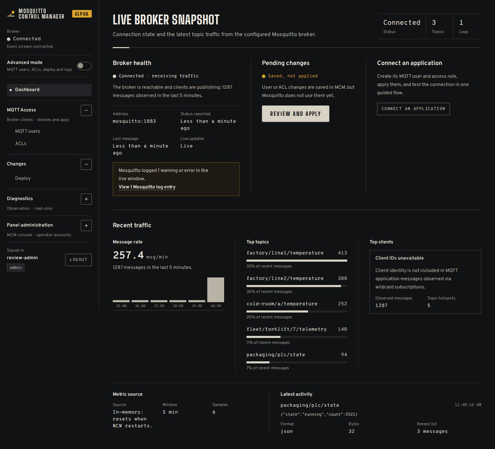
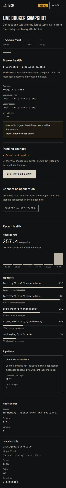
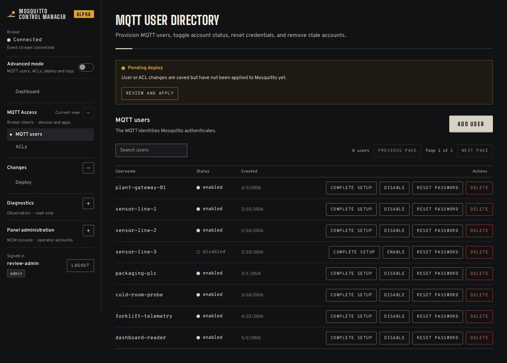
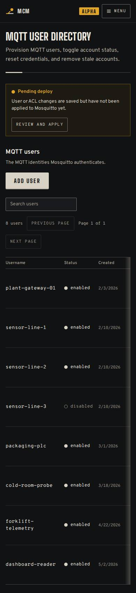
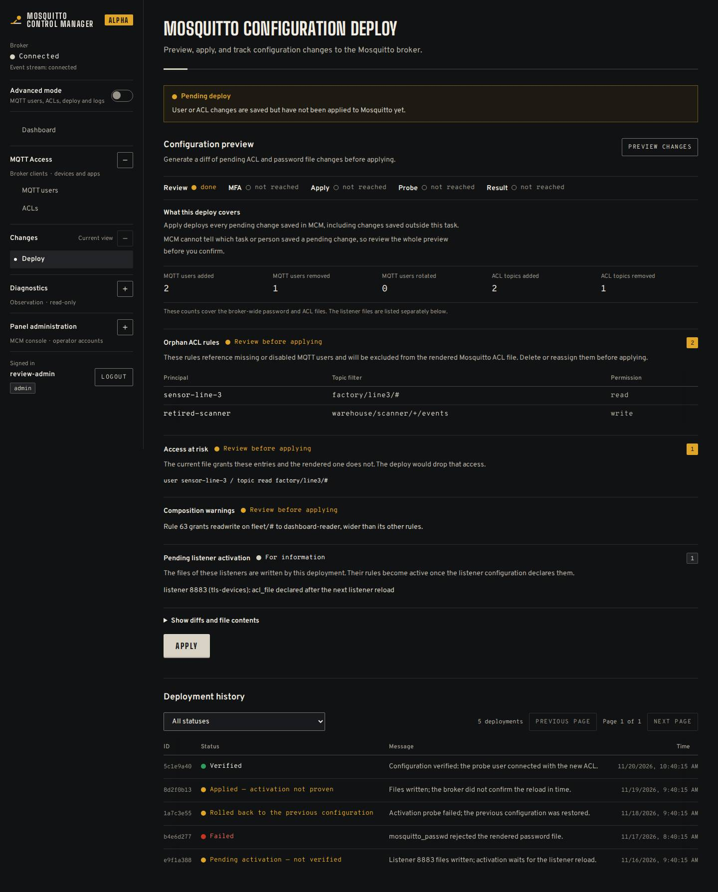
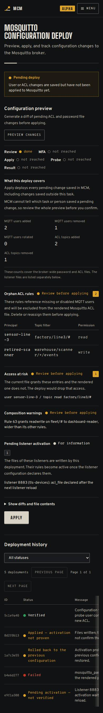
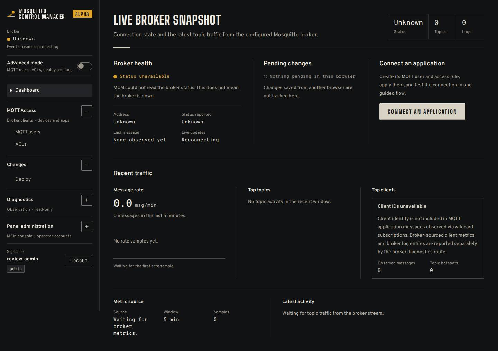
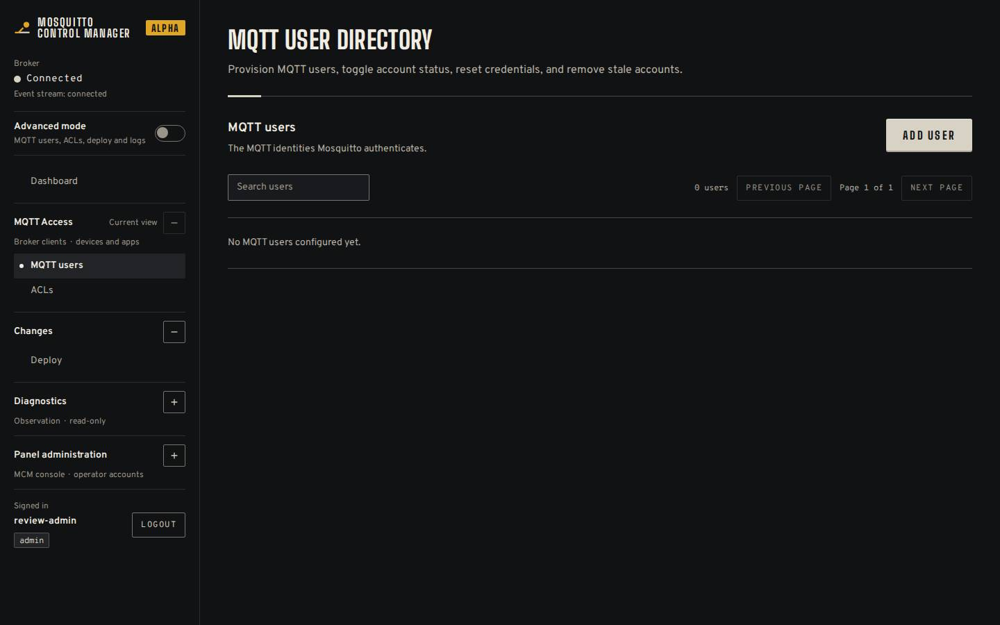

# Operational views: hierarchy and accessibility review

Review of the three operational views (issue #359): Dashboard (`/`), MQTT users
(`/users`) and Deploy (`/deploy`), on desktop and mobile, in the empty, loaded
and error states. It checks that each view has one primary action, the text
contrast, reflow at 200% and 400% zoom, a visible keyboard focus, and the three
keyboard journeys of S6. The screenshots below come from this run.

Last run: 2026-11-20, branch `feat/359-operational-hierarchy` (commit 7015496 plus
the working tree, with defects 1-4 of the first run fixed), Chromium headless
shell 1248.

## How to run

```sh
npm --prefix frontend run build
node frontend/e2e/operational-review.mjs [output-dir]
```

The script serves `frontend/dist` with Vite's `preview()` on `127.0.0.1:4319`. It
answers every `/api/v1/**` request and the broker event WebSocket
(`/api/v1/broker/events`) with fixtures, and signs in by putting a fake token
in `localStorage` (`mcm_admin_token`). No backend, no broker and no real
credentials are involved. Requests that no fixture covers get a 404 and are
listed in the results. In this run there were none, and there were no page
errors.

The output goes to `frontend/e2e/output/operational-review/`, which git ignores:

- `results.json` with every measurement;
- `summary.md` with the tables and findings;
- one full-page JPEG per screen;
- a cropped JPEG for each focus finding, and a full-page JPEG for each reflow
  failure.

The script does not empty the directory first, so evidence files of an earlier
run can stay there; `summary.md` names the files of the current run.

The run takes about 35 seconds. The script reports and never gates, so it exits
with 0 even when it finds defects.

If the installed Playwright browser does not match the revision that
`@playwright/test` expects, point it at an installed Chromium:

```sh
PLAYWRIGHT_CHROMIUM_PATH=~/.cache/ms-playwright/chromium_headless_shell-1248/chrome-headless-shell-linux64/chrome-headless-shell \
  node frontend/e2e/operational-review.mjs
```

## Matrix and fixtures

- **Viewports:** desktop 1440×900 and mobile 390×844.
- **States:**
  - **Empty:** the broker is connected with no traffic; there are no MQTT users,
    no deployment history and nothing pending; the preview has no changes.
  - **Loaded:** 8 MQTT users, one of them disabled; 1,287 messages with five top
    topics, three live topic messages and one Mosquitto warning; pending changes
    in this browser; a preview with changes, 2 orphan rules, one access-at-risk
    entry, one composition warning and one pending listener activation; a history
    with Verified, Applied (activation not proven), Rolled back, Failed and
    Pending activation entries.
  - **Error:** `/api/v1/status` answers 503 and the event stream closes; the
    MQTT users and deployments lists answer 500; the preview answers 500.
- **Role:** admin, so every lever can be shown.
- **Deploy:** the screen is measured after the preview has been generated.

## Checks

- **Primary levers:** the number of visible buttons in `main` drawn with
  `leverPrimary` (`frontend/src/features/ui/styles.ts`). The expected number is
  one.
- **Contrast:** every visible text node, plus input values and placeholders, is
  measured against its composited background. The browser paints the colours
  (oklch, colour-mix and alpha) on a canvas. A failure is below 4.5:1, or below
  3:1 for large text (24px, or 18.66px bold). Text of disabled controls is
  exempt (WCAG 1.4.3).
- **Reflow:** the viewport is narrowed to 320 CSS px (the 400% zoom of a 1280px
  window) and to 640 CSS px (200%). A failure is any horizontal scroll of the
  document. A wide table that scrolls inside its own region is allowed. The
  innermost element that overflows is named as the cause.
- **Focus:** the script tabs from the top of the document through up to 60
  stops. Each focused element needs:
  - an outline of at least 2px, or a box-shadow ring with a spread of at least
    2px;
  - an outline contrast of at least 3:1 against the background;
  - an outline that the overflow of its ancestors does not clip on every side.
    Partial clipping is reported as a note.

  CSS transitions are finished before the measurement.
- **Keyboard journeys:** they run in the loaded state, on desktop unless marked
  as mobile, and count the Tab presses from the top of the document.

## Results

A focus count of "1 (11)" means 1 failing stop out of 11 stops.

| View | Viewport | State | Primary levers | Contrast failures (texts checked) | Reflow 320 | Reflow 640 | Focus failures (stops) |
| --- | --- | --- | --- | --- | --- | --- | --- |
| Dashboard | desktop | empty | 1 (Connect an application) | 0 (72) | ok | ok | 0 (11) |
| Dashboard | desktop | loaded | 1 (Review and apply) | 0 (101) | ok | ok | 0 (13) |
| Dashboard | desktop | error | 1 (Connect an application) | 0 (72) | ok | ok | 0 (11) |
| Dashboard | mobile | empty | 1 (Connect an application) | 0 (53) | ok | ok | 0 (2) |
| Dashboard | mobile | loaded | 1 (Review and apply) | 0 (82) | ok | ok | 0 (4) |
| Dashboard | mobile | error | 1 (Connect an application) | 0 (53) | ok | ok | 0 (2) |
| MQTT users | desktop | empty | 1 (Add User) | 0 (32) | ok | ok | 0 (11) |
| MQTT users | desktop | loaded | 1 (Add User) | 0 (94) | ok | ok | 0 (44) |
| MQTT users | desktop | error | 1 (Add User) | 0 (32) | ok | ok | 0 (11) |
| MQTT users | mobile | empty | 1 (Add User) | 0 (12) | ok | ok | 0 (3) |
| MQTT users | mobile | loaded | 1 (Add User) | 0 (74) | ok | ok | 0 (36) |
| MQTT users | mobile | error | 1 (Add User) | 0 (12) | ok | ok | 0 (3) |
| Deploy | desktop | empty | 1 (Preview Changes) | 0 (44) | ok | ok | 0 (11) |
| Deploy | desktop | loaded | 1 (Apply) | 0 (120) | ok | ok | 0 (17) |
| Deploy | desktop | error | 1 (Preview Changes) | 0 (44) | ok | ok | 0 (11) |
| Deploy | mobile | empty | 1 (Preview Changes) | 0 (24) | ok | ok | 0 (3) |
| Deploy | mobile | loaded | 1 (Apply) | 0 (100) | ok | ok | 0 (10) |
| Deploy | mobile | error | 1 (Preview Changes) | 0 (24) | ok | ok | 0 (3) |

- **Primary levers:** every screen has exactly one (S4).
- **Reflow:** every screen reflows at 320px and at 640px.
- **Focus:** no stop fails. The only notes are defect 6 below.
- **Contrast:** no text fails. The lowest ratios are:
  - Dashboard: 6.22:1 (the `dt` labels);
  - MQTT users: 5.77:1 (the search placeholder);
  - Deploy: 5.77:1 (diff text), 6.07:1 (error notices) and 6.22:1 (route stage
    words).
- **Mobile focus counts:** on mobile the navigation is folded behind Menu, so the
  focus pass covers the Menu button and `main`. The navigation links are reached
  by the mobile journey below.

## Keyboard journeys

| Journey | Step | Tab presses | Result |
| --- | --- | --- | --- |
| Dashboard (desktop) | Tab to the primary lever "Review and apply", then Enter | 12 | Opens `/deploy` |
| Dashboard (desktop) | Tab to the MQTT users navigation link, then Enter | 4 | Opens `/users` |
| Dashboard (mobile 390) | Tab to Menu, then Enter | 1 | The menu opens |
| Dashboard (mobile 390) | Tab to the MQTT users link, then Enter | 4 | Opens `/users`; the menu closes |
| MQTT users | Tab to the search, type `sensor-line-3` | 12 | One row is read: `sensor-line-3` · `disabled` |
| MQTT users | Tab to that row's Delete, then Enter | 4 | Focus moves to Cancel |
| MQTT users | Enter on Cancel | 0 | Focus returns to the same row's Delete |
| Deploy | Tab to Preview Changes, then Enter | 10 | The preview is generated; focus stays on Preview Changes |
| Deploy | Tab to Apply, then Enter | 6 | The apply is armed; focus moves to the MFA code field |
| Deploy | The MFA code field | 0 | Focus is already there. The journey stops and applies nothing. |

All three journeys can be completed with the keyboard alone (S6). In the first
run the deploy journey lost focus twice and needed 19 more presses to reach the
MFA code field (defect 2).

## Defects found

The first run found six defects. Defects 1-4 are fixed and the run above
confirms it; 5 and 6 are known follow-ups.

1. **Fixed: no visible focus on a navigation link alone in its group (WCAG
   2.4.7).** The group's `overflow-hidden` and the aside's `overflow-y-auto`
   clipped the outline drawn 3px outside the link. Nav links now draw it inside
   (`focus-visible:outline-offset-[-2px]`, `DashboardFrame.tsx`).
2. **Fixed: focus lost in the deploy route (WCAG 2.4.3, S6).** Preview Changes
   is `aria-disabled` while generating, not `disabled`, and ignores presses then
   (`App.tsx`), so it keeps focus; arming Apply moves focus to the confirmation's
   first control, the MFA code field or, with a recent proof, Confirm
   (`ChangeRoute.tsx`). Once MFA is verified its form turns into text, so focus
   moves on to Confirm; Cancel returns focus to Apply.
3. **Fixed: the deploy history filter broke reflow at 320px (WCAG 1.4.10).** The
   filter select has `max-w-full` and its row `min-w-0`, so its longest option no
   longer widens the page (`ListControls.tsx`).
4. **Fixed: the frame said "Disconnected" while the status was unknown (S4).**
   The sidebar lamp and the header Status metric say "checking" while the status
   loads and "unknown" with an amber lamp when it cannot be read; connected or
   disconnected only once read (`DashboardFrame.tsx`).
5. **Follow-up: lists that fail to load still show "0 users" or "0 deployments"
   and the pagination next to the load error (low).** Seen on MQTT users and
   Deploy in the error state (`ListControls.tsx`).
6. **Follow-up: row actions at the edge of a scrolling table lose one side of
   their outline (low).** This is a note, not a failure, because three sides stay
   visible. It affects Delete on desktop (8 rows), and on mobile Reset password,
   Delete and Complete setup at the edges of the scroll region
   (`table-scroll` clips the outline).

Observations that are not WCAG failures:

- There is no skip link, so the first stop in `main` comes after 9 or 10
  sidebar stops. The Dashboard primary lever takes 12 presses, the users
  search 12 and Preview Changes 10. WCAG 2.4.1 is met by the `main` landmark and
  the headings.
- On mobile, the actions of the MQTT users table sit off-screen in the
  horizontal scroll, which makes every row tall.

## Screenshots

Selected screenshots are kept in `operational-views/`. The others are
regenerated by the script. No real credential or token appears in them: the
signed-in user is the fixture `review-admin`, and no password is revealed.

| Screen | File |
| --- | --- |
| Dashboard, desktop, loaded |  |
| Dashboard, mobile, loaded |  |
| MQTT users, desktop, loaded |  |
| MQTT users, mobile, loaded |  |
| Deploy, desktop, loaded (preview generated) |  |
| Deploy, mobile, loaded (preview generated) |  |
| Dashboard, desktop, error (the frame says "Unknown") |  |
| MQTT users, desktop, empty |  |

## Visual critique (S3)

Impeccable was used for critique input only. It is not installed in this
repository and nothing here depends on it. Its 2026-11-13 critique of
`frontend/src` was the visual input for #359. It flagged card-in-card nesting,
buttons of equal weight and the cognitive load of Deploy, and a2b1b33 answered
those points with one primary lever per view and worded severity on the preview
blocks. This review checks the result in a browser with the script above, which
uses only Playwright, already a dev dependency.

## Limits

- **Zoom:** zoom is approximated by the CSS viewport width (320 and 640 px).
  Browser zoom and text-only zoom (WCAG 1.4.4) were not exercised.
- **Contrast:**
  - The background is composited from the background colours of the ancestors.
    Text over a gradient uses the colour behind the gradient, and text over a
    positioned sibling is not handled.
  - Non-text contrast (borders of inputs and lamps, WCAG 1.4.11) is checked only
    for the focus outline.
  - Hover and pressed states are not measured.
- **Not checked:** a focused element hidden under a sticky region (WCAG 2.4.11),
  and screen reader output.
- **Fixtures:** the fixtures follow the shapes used in `frontend/src/App.test.tsx`
  and `useBrokerStream.ts`. They do not reproduce real server timing.
